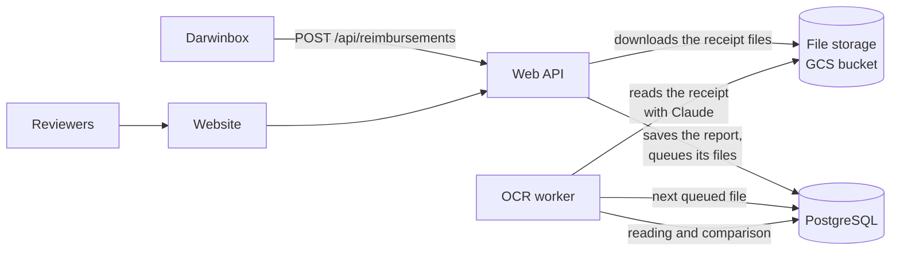

# Reimbursement review

An internal Blibli tool that checks employees' fuel (BBM) reimbursement claims against their receipts.

Other systems (Darwinbox) send the reimbursement reports to an API. Claude reads each receipt file (OCR), and plain
code compares what it read with what the employee submitted. A report whose receipt agrees is approved automatically;
every other report goes to a reviewer, who approves or rejects it on the website.

> **When in doubt, flag it.** A report flagged by mistake costs a reviewer a few seconds. Nothing is approved
> automatically without a clear reason.

| Part | What it is | Docs |
|---|---|---|
| [backend/](backend/) | Python: the web API (Flask), the OCR worker, the PostgreSQL schema | [backend/README.md](backend/README.md) |
| [website/](website/) | React: the review website for reviewers, in Indonesian or English | [website/README.md](website/README.md) |

---

## How it works



1. **Receive.** Darwinbox sends reports in batches (about once a week). The API checks each report, downloads the
   receipt files of its items right away (Darwinbox's links expire after 10 minutes), keeps them in the file storage
   and saves the report. A report is stored once and never changed: sent again with the same data it stores nothing
   new; a corrected report comes under a new code.
2. **Read.** The OCR worker takes the queued files one by one (a file sent with several items is read once). Claude
   (through the Claude Code CLI) reads every receipt on the file into structured data: date, products, liters,
   prices, totals.
3. **Compare.** Plain code pairs the receipts of a file with the items it was sent with and compares them field by
   field (the fuel type Darwinbox sends, like "Pertamax 92", against the names receipts print, like "PERTAMAX"; the
   amount ÷ the volume against the price per liter printed, within 0.5 %). A difference that is only an OCR misread
   (the receipt's own arithmetic proves the submitted value right) is explained; every other difference is flagged.
4. **Decide.** No differences: approved (`matched`). Only explained misreads: approved (`proceed`). Anything else:
   the report needs review. So does a report whose receipt an earlier report already claimed (a possible double
   claim: the same file, or the same employee's receipt with the same day, amount and volume), whatever the OCR
   found; resending a receipt a reviewer rejected is a resubmission, not a double claim.
5. **Review.** Reviewers work through the reports that need review on the website. They see the receipt next to the
   submitted data with every difference marked, then approve or reject with a reason. They can also comment,
   spot-check the automatic approvals and export a list to Excel.

**Fuel prices.** The website also lists the DKI Jakarta price per liter of every fuel at Pertamina, Shell, BP and
Vivo, with its history. The OCR worker refreshes them from the web when someone presses "Update from the web" or a
new batch of reports arrives, at most once a day whichever starts it: Claude reads Pertamina's and Shell's own price lists, and
recent news articles for BP and Vivo (they publish none that can be read). A new price is stored only when the line
quoted from the page backs it, and, from the news, two news sites agree (see
[backend/README.md](backend/README.md#fuel-price-refresh)).

### Review statuses

| Status | Meaning |
|---|---|
| **Needs review** | A reviewer must decide: an earlier report claims the same receipt (possible double claim), the OCR found differences it can't explain, or it couldn't read the file (after 3 tries) |
| **Processing** | The OCR hasn't read the file yet |
| **Approved** | The receipt matches (`matched`), the only differences are OCR misreads (`proceed`), or a reviewer approved it |
| **Rejected** | A reviewer rejected it; Darwinbox can send a corrected report under a new code |

A reviewer's decision always wins and stays final; a later OCR reading never changes it. A corrected report sent
after a rejection is a new report with its own code, judged on its own like any other.

Every report belongs to the month it was **received** in (WIB), not the day the employee submitted it: a claim
submitted on 31-10 and sent by Darwinbox on 2-11 counts for November.

---

## Getting started (local)

**You need:** Python 3.11, Node.js 24, PostgreSQL 15 (with `psql` on the PATH), and the Claude Code CLI (`claude`)
logged in (`claude auth login`) for the OCR worker.

1. **Settings.** Copy [.env.copy](.env.copy) to `.env` and fill in the database settings (`DB_*`).
2. **Python libraries.**
   ```bash
   pip install -r requirements.txt
   ```
3. **Database.** Create an empty database, then build the tables and fill them with sample data:
   ```bash
   py -m backend.database.reset rebuild
   ```
4. **API** (http://127.0.0.1:5000/api):
   ```bash
   py -m backend.app
   ```
5. **OCR worker**, in a second terminal:
   ```bash
   py -m backend.jobs.bbm_ocr.worker
   ```
6. **Website** (http://localhost:5173), in a third terminal; pick a user on the login page:
   ```bash
   cd website
   npm install
   npm run dev
   ```

To send reports the way Darwinbox does, run one of the PowerShell scripts in [curl-testing/](curl-testing/) while the
API is running (`curl-1.txt` .. `curl-4.txt`, about 20 reports each). The worker reads their receipts within a minute
or so.

For a month's volume, [send_month.ps1](curl-testing/send_month.ps1) sends 200 reports a week, in requests of 100, for
the weeks you pick. Every new report is one Claude OCR run (about 25 seconds), so a week is about an hour and a half
of reading; sending a week again costs nothing.

```powershell
powershell -ExecutionPolicy Bypass -File curl-testing\send_month.ps1 -Week 1
```

The sample data already has such a month with its OCR results, at no cost: September 2026 (800 reports, from
[dummy_month.sql](backend/database/seeds/dummy_month.sql)).

After pulling a change to `backend/database/schema.sql`, run `py -m backend.database.reset rebuild` again; it
deletes everything in your local database and seeds it again.

### Run it with Docker

```bash
docker compose up --build                 # website, API and a database of its own: http://localhost:8080
docker compose --profile ocr up --build   # the same, plus the OCR worker (needs ANTHROPIC_API_KEY in .env)
```

The [Dockerfile](Dockerfile) builds three images: `web` (nginx serving the website and forwarding `/api`), `api`
(gunicorn) and `worker` (the OCR worker with the Claude Code CLI). [docker-compose.yml](docker-compose.yml) is for
trying them locally only; production runs the same images with its own settings.

---

## Configuration

Every setting is an environment variable; locally they come from `.env` (template: [.env.copy](.env.copy)).

| Variable | Used by | What it is |
|---|---|---|
| `DB_HOST`, `DB_PORT`, `DB_NAME`, `DB_USER`, `DB_PASSWORD` | API, worker | The PostgreSQL database (default host `localhost`, port `5432`) |
| `ATTACHMENT_HOSTS` | API | The hosts receipt files may be downloaded from (`host` or `host:port`, comma-separated). Empty allows any host: local development only |
| `GCS_BUCKET` | API, worker | The private Google Cloud Storage bucket for the receipt files. Empty: a local folder (`backend/storage/`). Access comes from the service account (Application Default Credentials), not a key |
| `ANTHROPIC_API_KEY` | worker | The organization's Claude API key, used by the Claude Code CLI. Empty: your own `claude auth login` |

---

## Repository layout

```
reimbursement/
├── backend/              # web API, OCR worker, database (backend/README.md)
├── website/              # review website (website/README.md)
├── Database Design/      # the ERD: Visual Paradigm project (.vpp) and an exported picture (.jpg)
├── docker/nginx/         # nginx settings for the web image
├── curl-testing/         # PowerShell scripts that send sample reports to a local API
├── Dockerfile            # the web, api and worker images
├── docker-compose.yml    # the whole setup on one machine, for trying it locally
├── requirements.txt      # Python libraries
└── .env.copy             # template of .env (no real values)
```
