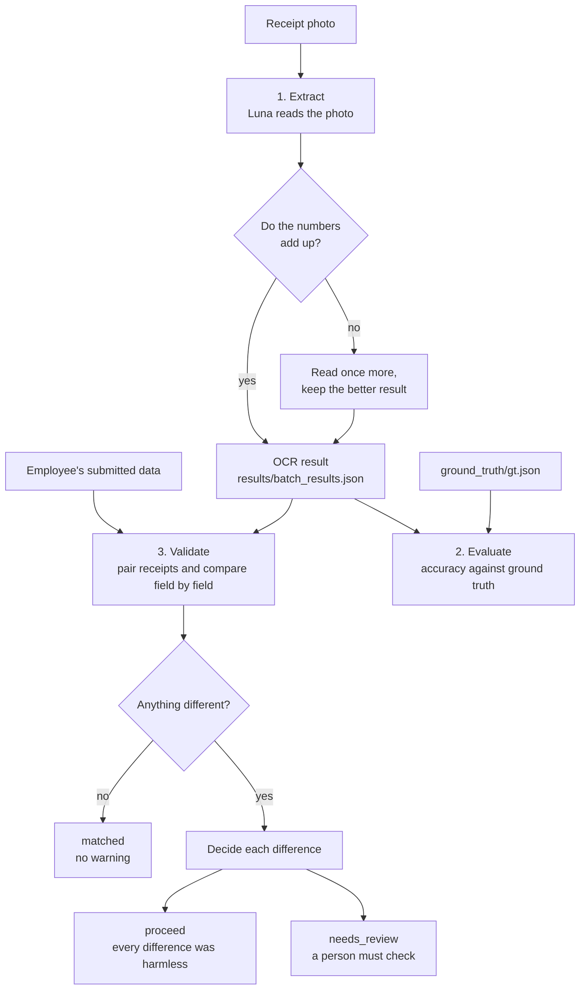

# Reimbursement: gas-station receipt validation

An employee submits a reimbursement claim (date, products, quantities, prices, total). A validator must check
that the claim matches the **gas-station receipt photo**. This project does that check automatically:

1. **Extract** - an AI model reads the receipt photo and returns structured data (OCR).
2. **Compare** - plain code compares the submitted data with the OCR field by field.
3. **Decide** - harmless differences are approved, everything else is flagged for a person.
   **JEV** (TypeSafe System One) judges whether a different *product name* is only noise,
   and plain arithmetic judges a single wrong *number*.

> **Principle: when in doubt, flag it.** A wrongly flagged receipt costs a person a few seconds.
> Nothing is approved unless there is a clear reason.

Status: the extraction, evaluation and validation pipeline works from the command line.
The HTTP route (`routes.py`) is still a template and is not part of this document yet.

---

## Quick start

```bash
pip install -r requirements.txt
```

Open [main.py](main.py), set `MODE`, then run it from this folder:

```bash
py main.py
```

| `MODE` | What it does | Needs |
|---|---|---|
| `"extract"` | OCR every image in `images/` and save `results/batch_results.json` | The OCR model (see [Models](#models-luna-now-haiku-on-vertex-planned)) |
| `"evaluate"` | Measure OCR accuracy against `ground_truth/gt.json` | `results/batch_results.json` and the ground truth |
| `"validate"` | Compare submitted data with the OCR and decide matched / proceed / needs_review | `results/batch_results.json`, the submitted data and the JEV settings |

A normal order is `extract`, then `evaluate`, then `validate`. Extraction costs tokens and takes minutes,
so run it only when the images or the model change.

---

## Folder layout

```
reimbursement/
├── main.py                          # entry point with the three modes
├── routes.py                        # API template, not built yet (returns 501)
├── gas_station_receipt.schema.json  # the JSON shape the OCR must return (with confidence descriptions)
├── .env                             # JEV and (later) Vertex AI settings (not in git)
├── .env.copy                        # the same variable names without real values; copy it to .env
├── requirements.txt                 # Python libraries
├── .gitignore
├── images/                          # receipt photos named 1.jpg, 2.jpeg, ... (the name is the image id; only 13 sample images are in git)
├── ground_truth/gt.json             # the correct data for every image
├── results/                         # everything the pipeline writes
│   ├── batch_results.json           #   OCR output
│   ├── batch_results_usage.json     #   OCR token usage and time
│   ├── evaluation_report/           #   accuracy reports (.json, .txt, errors .csv)
│   ├── validation_results.json      #   full validation result per image
│   ├── unmatched_cases.json         #   only the images that are not "matched"
│   └── jev_usage.json               #   JEV calls and tokens
└── src/
    ├── receipt_config.py            # paths and comparison settings
    ├── receipt_extraction.py        # loops over all images (extract mode)
    ├── receipt_ocr_luna.py          # OCR with Luna through the Codex CLI  <- in use now
    ├── receipt_ocr_haiku.py         # OCR with Claude Haiku 5.5 on Vertex AI <- planned replacement
    ├── receipt_evaluation.py        # accuracy against the ground truth
    ├── receipt_validation.py        # comparison, JEV, arithmetic, statuses
    └── receipt_utils.py             # JSON load/save helpers
```

---

## How it works



### 1. Extraction ([receipt_ocr_luna.py](src/receipt_ocr_luna.py), [receipt_extraction.py](src/receipt_extraction.py))

- For every image, `extract_receipts(image, schema)` starts the **Codex CLI** with the model `gpt-6-luna` at effort `xhigh`,
  gives it the image and the schema, and reads the JSON answer.
- One image can hold **several receipts**. The result is `{"receipts": [ ... ]}`, one entry per physical receipt.
- Every field has a **confidence** from 0.0 to 1.0, defined in the schema descriptions.
  Confidence is shown to reviewers as a hint only. It never decides anything, because wrong values were sometimes scored 0.99.
- **Consistency check and retry.** After reading, `receipt_problems()` checks that the numbers agree with each other:
  `quantity x unit_price` is within 150 rupiah of `total_price`, `sum(total_price) - discount` equals `total` (within 1 rupiah),
  no unit price under 1000, and no empty date, total or product field.
  If something is off, the image is read **once more** and the result with fewer problems is kept (`RETRIES = 1`).
  Token usage of both runs is added together, with a `retries` count.
- `extract_batch()` saves after every image, so a failure never erases the earlier results.

### 2. Evaluation ([receipt_evaluation.py](src/receipt_evaluation.py))

Compares the OCR with the ground truth to tell you how good the OCR is, not to check a claim.
Receipts are matched one-to-one by best overall fit, products by name, numbers with a small tolerance, dates after parsing
(so `26/05/2026` equals `26-05-2026`). It writes the reports to `results/evaluation_report/`.

Latest run (63 images, 80 receipts, Luna): **98.57 %** of fields correct, **91.25 %** of receipts completely correct,
receipt count correct in every image. The remaining errors are dates (3), names (3), one total and one total price.

### 3. Validation ([receipt_validation.py](src/receipt_validation.py))

`validate_batch(submitted, ocr)` handles every image in this order:

**a) Pair.** Each submitted receipt is matched to the OCR receipt it resembles most (one-to-one, best overall fit),
so several receipts in one image work. Products inside a receipt are matched by how many of their four fields agree (name, quantity, unit price, total price), with name similarity as a tie-breaker.
A receipt that exists on one side only is flagged.

**b) Compare field by field in plain code.** Names ignore case, spaces and punctuation, dates are parsed, numbers use a tolerance.
Fields that match need nothing more. A receipt with no differences is `matched`.

**c) Decide every difference.**

| What differs | Who decides | Result |
|---|---|---|
| **Product name** | **JEV** (see below) | Resolved if it says "same product" with probability 0.85 or more; otherwise flagged |
| **One number** (`quantity`, `unit_price`, `total_price`, `total`, `discount`) | **Arithmetic in code** | Resolved if only the submitted value fits the other numbers on the receipt; otherwise flagged |
| **Date** | Nobody can judge it | Flagged immediately |
| **Several numbers** on one receipt | One misread cannot explain it | Flagged |
| **Missing or extra product / receipt** | Not judged | Flagged |
| JEV unreachable or unsure | - | Flagged |

**d) Status.** A receipt is `matched` (no differences), `proceed` (every difference was resolved) or `needs_review`.
The image is `needs_review` if any receipt needs review or any receipt is unpaired, else `proceed` if anything was resolved, else `matched`.

Every difference carries a plain-language **hint** that tells the reviewer why it was flagged
(for example *"The OCR total fits the other numbers; the submitted value does not. The submitted value is probably wrong."*),
plus the OCR confidence as information.

#### How JEV is used

JEV is a classifier API: it receives a JSON `state` and a list of `questions` and returns probabilities plus token usage.
It **cannot see images** and it **cannot do arithmetic reliably** (it solved 11 of 30 test sums), so it is used for one thing only:
deciding whether two product names mean the same fuel.

```
POST {JEV_BASE_URL}/v1/systemone
Authorization: Bearer {JEV_API_KEY}

{
  "model": "{JEV_MODEL}",
  "state": {
    "submitted_name": "pertamax",
    "ocr_name": "PERTAMAX Hose 10.3",
    "ocr_name_confidence": 0.84
  },
  "questions": {
    "same_product": {
      "type": "noul",
      "instructions": "Do submitted_name and ocr_name refer to the same fuel product (same fuel type and grade)? Ignore extra words, codes, pump or hose numbers, casing and spelling. ...",
      "criteria": {
        "true":  "Same fuel product; the difference is only noise or an OCR slip.",
        "false": "A different fuel type or grade, or an unrelated name. Different grades such as Pertalite, Pertamax, Pertamax Turbo, Pertamax Green, Pertamina Dex, Dexlite, Solar and Biosolar are different products."
      }
    }
  }
}
```

- The answer is read from `answers.same_product.noul` (probability that the names are the same).
  **At 0.85 or more** the difference counts as harmless; below that it is flagged.
- **Only the names are sent.** Earlier tests with the prices and quantities in the state made harmless and real differences harder to tell apart.
- Failures (timeout, HTTP 429 or 5xx, bad reply, missing settings) are retried up to 3 times with backoff, then the receipt is flagged. JEV being down never approves anything.
- **Usage is logged.** Every image result has `jev_usage` (calls, input/output tokens, seconds), and `results/jev_usage.json` has the batch total and the per-image breakdown.
- **Arithmetic stays in code.** `quantity x unit_price` is compared with `total_price` (allowed gap: 0.5 %, at least 100 rupiah),
  and `sum(total_price) - discount` with `total` (1 rupiah). These limits come from the real data
  (quantity x unit price is within 0.5 % of the printed amount for 99 % of products).

**What it looks like on real data:** most images come out `matched`. JEV is only called for the few name differences,
for example `pertamax` vs `PERTAMAX Hose 10.3` (pump number noise) or `SUPER` vs `05 SUPER`.
The receipts that still need a person are almost all **date** differences, which no automatic check can settle.

---

## Data formats

**Submitted data** (the same shape as `ground_truth/gt.json`), keyed by image id:

```json
{
  "14": [
    {
      "date": "18-12-2025",
      "discount": 0,
      "total": 450000,
      "products": [
        { "name": "pertamax", "quantity": 35.5, "unit_price": 12300, "total_price": 436650 }
      ]
    }
  ]
}
```

**OCR data** (`results/batch_results.json`) has the same shape, with extra `confidence` blocks:

```json
{ "date": "18-12-2025", "discount": 0, "total": 436650, "confidence": { "date": 0.97, "discount": 0.99, "total": 0.99 },
  "products": [ { "name": "PERTAMAX Hose 10.3", "quantity": 35.5, "unit_price": 12300, "total_price": 436650,
                  "confidence": { "name": 0.84, "quantity": 0.99, "unit_price": 0.99, "total_price": 0.99 } } ] }
```

Rules: `discount` is `0` when there is none, other unreadable values are `null`, money is a plain number in rupiah,
`quantity` is in liters. Until a real "employee submitted" file exists, validate mode uses `ground_truth/gt.json` as the submitted data
(`SUBMITTED_PATH` in [main.py](main.py)), so a validation run mostly shows that correct claims pass.

---

## Configuration

`.env` in this folder (never commit it; `.env.copy` lists the names):

| Variable | Used for |
|---|---|
| `JEV_BASE_URL` | JEV server address |
| `JEV_API_KEY` | JEV login (Bearer token) |
| `JEV_MODEL` | JEV model name |
| `GCP_PROJECT_ID`, `GCP_REGION` | Vertex AI, only for the Haiku OCR (not used with Luna) |

Settings in the code you may want to tune:

| Setting | Where | Value |
|---|---|---|
| OCR model and effort | `MODEL`, `EFFORT` in `receipt_ocr_luna.py` | `gpt-6-luna`, `xhigh` |
| Retry on inconsistent OCR | `RETRIES`, `PRODUCT_MATH_TOLERANCE`, `TOTAL_MATH_TOLERANCE`, `MIN_UNIT_PRICE` in `receipt_ocr_luna.py` | 1, 150, 1, 1000 |
| JEV approval threshold | `JEV_PROCEED_THRESHOLD` in `receipt_validation.py` | 0.85 |
| Arithmetic tolerance | `PRODUCT_REL_TOLERANCE`, `PRODUCT_ABS_FLOOR`, `RECEIPT_ABS_TOLERANCE` in `receipt_validation.py` | 0.5 %, floors, 1 rupiah |
| Paths, matching modes | `receipt_config.py` | - |