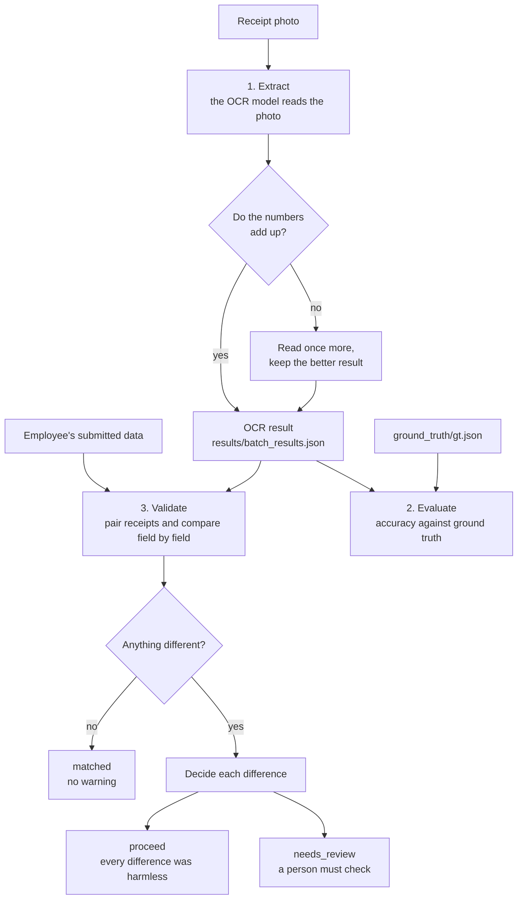

# Reimbursement: gas-station receipt validation

An employee submits a reimbursement claim (date, products, quantities, prices, total). A validator must check
that the claim matches the **gas-station receipt photo**. This project does that check automatically:

1. **Extract** - an AI model reads the receipt photo and returns structured data (OCR).
2. **Compare** - plain code compares the submitted data with the OCR field by field.
3. **Decide** - harmless differences are approved, everything else is flagged for a person.
   Plain arithmetic judges a single wrong *number*; every other difference goes to a person.

> **Principle: when in doubt, flag it.** A wrongly flagged receipt costs a person a few seconds.
> Nothing is approved unless there is a clear reason.

Status: the extraction, evaluation and validation pipeline works from the command line.
The web API (`py -m backend.app`, every endpoint is in [routes.py](backend/routes.py)) receives the reimbursement reports of
other systems (`POST /api/reimbursements`; a BBM report has one file, which may show several receipts) and serves the review website: the development login, the reports with their OCR
results (a page at a time: `GET /api/reimbursements?type=bbm&period=&status=&by=&q=&sort=&page=`; the counts per month
and status: `GET /api/reimbursements/summary`; the codes of a list: `GET /api/reimbursements/codes`), comments (each
reviewer can edit and delete only their own), the reviewers' decisions
(`POST /api/reimbursements/<code>/decisions`: approve, reject with a reason, or take back), retrying the OCR on files it
could not read (`POST /api/reimbursements/<code>/ocr/retry`, or for a whole list: `POST /api/reimbursements/ocr/retry`), an Excel export of a
list (`POST /api/reimbursements/export?type=bbm`; both take the list's filter as their body), and the receipt files (`GET /api/attachments/<id>/file`). See [website/README.md](website/README.md).

The file links in a report expire soon (Darwinbox's after 10 minutes), so `POST /api/reimbursements` downloads every
file right away and keeps it in our file storage (a GCS bucket; a local folder in development) before saving the report;
the website and the OCR read it from there. Each call queues the files of its new revisions for the OCR, as one OCR
process. The OCR worker reads them one at a time and stores what it read and the comparison; leave it running next to
the web API:

```bash
py -m backend.jobs.bbm_ocr.worker                  # add --once to stop when the queue is empty, --retry-failed to queue failed files again
```

Each report gets a **review status**: a reviewer's decision wins; otherwise a `matched` or `proceed` report is approved by
the OCR (a reviewer can still reject it), unless the revision before was rejected, then it needs review again; a file
the OCR couldn't read (after 3 tries) needs review too; the others stay `needs_review` or `processing` (the OCR has not
read the file yet). Decisions are kept in `review_decision`, newest in force.

---

## Quick start

```bash
pip install -r requirements.txt
```

Open [main.py](backend/main.py), set `MODE`, then run it from the repository root:

```bash
py -m backend.main
```

| `MODE` | What it does | Needs |
|---|---|---|
| `"extract"` | OCR every image in `images/` and save `results/batch_results.json` | The `claude` command logged in, see [Extraction](#1-extraction) |
| `"evaluate"` | Measure OCR accuracy against `ground_truth/gt.json` | `results/batch_results.json` and the ground truth |
| `"validate"` | Compare submitted data with the OCR and decide matched / proceed / needs_review | `results/batch_results.json` and the submitted data |

A normal order is `extract`, then `evaluate`, then `validate`. Extraction costs tokens and takes minutes,
so run it only when the images or the model change.

The data folders named in this document (`images/`, `ground_truth/`, `results/`) are inside `backend/jobs/bbm_ocr/`.

**Docker:** the [Dockerfile](Dockerfile) builds three images (`--target web`, `api`, `worker`);
`docker compose up --build` runs them locally with a database of their own on http://localhost:8080 (see the
comments in [docker-compose.yml](docker-compose.yml)).

---

## Folder layout

```
reimbursement/
├── requirements.txt                     # Python libraries
├── .gitignore
├── Database Design/                     # ERD (Visual Paradigm .vpp and an exported .jpg)
├── website/                             # review website, React frontend (see website/README.md)
└── backend/
    ├── main.py                          # entry point with the three modes (py -m backend.main)
    ├── app.py                           # web API for the website (py -m backend.app, http://127.0.0.1:5000/api)
    ├── routes.py                        # every API endpoint: URL -> service function
    ├── services/                        # handle the request, apply the rules, return JSON
    ├── repositories/                    # SQL on the PostgreSQL tables
    ├── database/                        # connection.py, schema.sql, seeds/
    └── jobs/                            # one folder per batch job
        └── bbm_ocr/                     # gas-station receipt OCR, evaluation and validation
            ├── gas_station_receipt.schema.json  # the JSON shape the OCR must return (with confidence descriptions)
            ├── images/                      # receipt photos and PDFs (up to 10 pages) named 1.jpg, 2.jpeg, 65.pdf, ... (the name is the image id; only 13 sample images are in git)
            ├── ground_truth/gt.json         # the correct data for every image
            ├── results/                     # everything the pipeline writes (current run)
            │   ├── batch_results.json       #   OCR output
            │   ├── batch_results_usage.json #   OCR token usage and time
            │   ├── evaluation_report/       #   accuracy reports (.json, .txt, errors .csv)
            │   ├── validation_results.json  #   full validation result per image
            │   └── unmatched_cases.json     #   only the images that are not "matched"
            ├── receipt_config.py            # paths and comparison settings
            ├── receipt_extraction.py        # loops over all images (extract mode)
            ├── results_<model>/             # finished runs kept for comparison: evaluation_report_<effort>_<retries>/
            ├── comparison.py                # compares the runs in results_<model>/ (writes comparison.txt)
            ├── receipt_ocr_haiku.py         # OCR with Claude through the Claude Code CLI
            ├── receipt_evaluation.py        # accuracy against the ground truth
            ├── receipt_validation.py        # comparison, arithmetic, statuses
            ├── receipt_records.py           # submitted items -> validation input; OCR reading -> database rows
            ├── worker.py                    # the OCR worker: reads the queued files (py -m backend.jobs.bbm_ocr.worker)
            └── receipt_utils.py             # JSON load/save helpers
```

---

## How it works



### 1. Extraction

[receipt_extraction.py](backend/jobs/bbm_ocr/receipt_extraction.py) loops over the images and calls `extract_receipts(image, schema)`
from [receipt_ocr_haiku.py](backend/jobs/bbm_ocr/receipt_ocr_haiku.py), which runs Claude through the **Claude Code CLI** (`claude -p`).
It needs `claude` installed, and logged in (`claude auth login`) or given an API key (`ANTHROPIC_API_KEY` in `.env`,
as deployed); usage counts against that Claude account or key.
`MODEL` and `EFFORT` at the top choose the model (Haiku 5.5 by default, Opus also works) and the effort.

Each call gives the model the image and the schema, and reads the JSON answer.
- One image can hold **several receipts**. The result is `{"receipts": [ ... ]}`, one entry per physical receipt.
- Every field has a **confidence** from 0.0 to 1.0, defined in the schema descriptions.
  Confidence is shown to reviewers as a hint only. It never decides anything, because wrong values were sometimes scored 0.99.
- **Consistency check and retry.** After reading, `receipt_problems()` checks that the numbers agree with each other:
  `quantity x unit_price` is within 150 rupiah of `total_price`, `sum(total_price) - discount` equals `total` (within 1 rupiah),
  no unit price under 1000, and no empty date, total or product field.
  If something is off, the image is read **once more** and the result with fewer problems is kept (`RETRIES = 1`).
  Token usage of both runs is added together, with a `retries` count.
- `extract_batch()` saves after every image, so a failure never erases the earlier results.

### 2. Evaluation ([receipt_evaluation.py](backend/jobs/bbm_ocr/receipt_evaluation.py))

Compares the OCR with the ground truth to tell you how good the OCR is, not to check a claim.
Receipts are matched one-to-one by best overall fit, products by name, numbers with a small tolerance, dates after parsing
(so `26/05/2026` equals `26-05-2026`). It writes the reports to `results/evaluation_report/`.

To compare models and settings, keep each run in `results_<model>/evaluation_report_<effort>_<retries>/`
(the `evaluation_report` folder plus `batch_results.json` and `batch_results_usage.json`) and run `py backend/jobs/bbm_ocr/comparison.py`.

Best runs so far (63 images, 80 receipts): Claude Opus `max` and Claude Haiku `max` with 1 retry, both **99.29 %** of fields
and **95 %** of receipts completely correct.
The dates of images 17 and 40 are read wrong by every model.

### 3. Validation ([receipt_validation.py](backend/jobs/bbm_ocr/receipt_validation.py))

`validate_batch(submitted, ocr)` handles every image in this order:

**a) Pair.** Each submitted receipt is matched to the OCR receipt it resembles most (one-to-one, best overall fit),
so several receipts in one image work. Products inside a receipt are matched by how many of their four fields agree (name, quantity, unit price, total price), with name similarity as a tie-breaker.
A receipt that exists on one side only is flagged.

**b) Compare field by field in plain code.** Names ignore case, spaces and punctuation, dates are parsed, numbers use a tolerance.
Fields that match need nothing more. A receipt with no differences is `matched`.

**c) Decide every difference.**

| What differs | Who decides | Result |
|---|---|---|
| **Product name** | Not judged | Flagged |
| **One number** (`quantity`, `unit_price`, `total_price`, `total`, `discount`) | **Arithmetic in code** | Resolved if only the submitted value fits the other numbers on the receipt; otherwise flagged |
| **Date** | Nobody can judge it | Flagged immediately |
| **Several numbers** on one receipt | One misread cannot explain it | Flagged |
| **Missing or extra product / receipt** | Not judged | Flagged |

**d) Status.** A receipt is `matched` (no differences), `proceed` (every difference was resolved) or `needs_review`.
The image is `needs_review` if any receipt needs review or any receipt is unpaired, else `proceed` if anything was resolved, else `matched`.

Every difference carries a plain-language **hint** that tells the reviewer why it was flagged
(for example *"The OCR total fits the other numbers; the submitted value does not. The submitted value is probably wrong."*),
plus the OCR confidence as information.

**Arithmetic tolerance.** `quantity x unit_price` is compared with `total_price` (allowed gap: 0.5 %, at least 100 rupiah),
and `sum(total_price) - discount` with `total` (1 rupiah). These limits come from the real data
(quantity x unit price is within 0.5 % of the printed amount for 99 % of products).

**What it looks like on real data:** most images come out `matched`. The receipts that need a person are mostly
**date** differences and product names written differently (for example `pertamax` vs `PERTAMAX Hose 10.3`).

---

## Data formats

**Submitted data** (the same shape as `ground_truth/gt.json`), keyed by image id:

```json
{
  "14": [
    {
      "date": "18-12-2025",
      "discount": 0,
      "total": 450000,
      "products": [
        { "name": "pertamax", "quantity": 35.5, "unit_price": 12300, "total_price": 436650 }
      ]
    }
  ]
}
```

**OCR data** (`results/batch_results.json`) has the same shape, with extra `confidence` blocks:

```json
{ "date": "18-12-2025", "discount": 0, "total": 436650, "confidence": { "date": 0.97, "discount": 0.99, "total": 0.99 },
  "products": [ { "name": "PERTAMAX Hose 10.3", "quantity": 35.5, "unit_price": 12300, "total_price": 436650,
                  "confidence": { "name": 0.84, "quantity": 0.99, "unit_price": 0.99, "total_price": 0.99 } } ] }
```

Rules: `discount` is `0` when there is none, other unreadable values are `null`, money is a plain number in rupiah,
`quantity` is in liters. Until a real "employee submitted" file exists, validate mode uses `ground_truth/gt.json` as the submitted data
(`SUBMITTED_PATH` in [main.py](backend/main.py)), so a validation run mostly shows that correct claims pass.

---

## Configuration

[.env.copy](.env.copy) lists every setting. Locally the OCR uses the logged-in `claude` command; deployed,
set `ANTHROPIC_API_KEY` (the organization's Claude API key) and the `claude` command uses it instead of a login.
The web API reads the database settings from `.env` in the repository root: `DB_HOST` (default `localhost`), `DB_PORT` (default `5432`), `DB_NAME`, `DB_USER`, `DB_PASSWORD`.
`ATTACHMENT_HOSTS` lists the hosts `POST /api/reimbursements` may download receipt files from (`host` or `host:port`,
comma-separated, e.g. `127.0.0.1:5000,files.example.com`); empty allows any host, so set it outside local development.
`GCS_BUCKET` is the private Google Cloud Storage bucket the files are kept in (credentials: Application Default
Credentials, e.g. Workload Identity; the service account needs to create and read objects). Without it, files are kept
in `backend/storage/` (development).

Settings in the code you may want to tune:

| Setting | Where | Value |
|---|---|---|
| Which OCR module | the first import in `receipt_extraction.py` | `receipt_ocr_haiku` |
| OCR model and effort | `MODEL`, `EFFORT` in the OCR module | e.g. `claude-haiku-5-5`, `max` |
| Retry on inconsistent OCR | `RETRIES`, `PRODUCT_MATH_TOLERANCE`, `TOTAL_MATH_TOLERANCE`, `MIN_UNIT_PRICE` in the OCR module | 0 or 1, 150, 1, 1000 |
| Arithmetic tolerance | `PRODUCT_REL_TOLERANCE`, `PRODUCT_ABS_FLOOR`, `RECEIPT_ABS_TOLERANCE` in `receipt_validation.py` | 0.5 %, floors, 1 rupiah |
| Paths, matching modes | `receipt_config.py` | - |